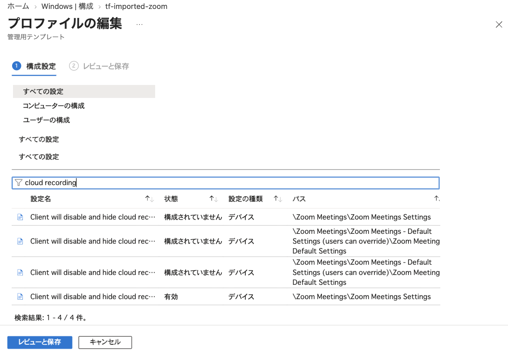

Microsoft Intune（以下、Intune）では、設定カタログやスクリプトなどの方法で、Windowsデバイスのレジストリに値を配布できます。
配布した値は、アプリケーションの更新に合わせて見直していくことになりますが、更新のしやすさや配布をやめたときの値の扱いは、方法によって異なります。

今回は、Intuneでレジストリに値を配布する主な5つの方法を、実機で確かめた結果とともに運用の観点で比べます。

検証した環境は次のとおりです。

| 項目 | 内容 |
| --- | --- |
| OS | Windows 11 Pro 25H2（ビルド26200.9457）[^windows-business] |
| 端末 | ARM64の仮想マシン |
| 管理 | Microsoft Entra参加、Intuneに登録 |
| ライセンス | Microsoft 365 Business Premium |
| ADMX | ZoomのADMX 6.6.5と7.2.0の`ZoomMeetings_HKLM.admx`[^zoom-admx] |

[^windows-business]: Microsoft 365 Business Premiumのライセンスにより、今回の環境ではWindows 11 Businessと表示されます。
[^zoom-admx]: Zoomのサポート記事[Mass-deploying with Group Policy Objects](https://support.zoom.com/hc/en/article?id=zm_kb&sysparm_article=KB0065466)から、バージョンごとのZIPファイルとしてダウンロードできます。

## Intuneでレジストリに値を配布する方法

値を書き込むのは、Windowsに組み込まれたPolicy CSPか、Intune管理拡張機能（IME: Intune Management Extension）が実行するPowerShellのスクリプトです。
Policy CSPは、MDMクライアント（Windowsに組み込まれた、IntuneなどのMDMから設定を受け取る機能）が受け取った設定をレジストリに書き込む部品で、IMEはWindowsデバイスに自動でインストールされるIntuneのエージェントです。

| 方法 | 書き込み元 | 書き込める場所 | 配布をやめたときの値 | 必要なライセンスの例 |
| --- | --- | --- | --- | --- |
| 設定カタログ | Policy CSP | Intuneが対応している設定 | 削除される | Microsoft Intune Plan 1[^intune-license] |
| ADMXのインポート | Policy CSP | アップロードしたADMXの設定 | 削除される | Microsoft Intune Plan 1 |
| カスタムプロファイル（OMA-URI） | Policy CSP | 取り込んだADMXの設定 | 削除される | Microsoft Intune Plan 1 |
| プラットフォームスクリプト | IME | 任意 | 残る | Microsoft Intune Plan 1 |
| 修復スクリプト | IME | 任意 | 残る | Microsoft 365 E3、E5など[^remediations-license] |

[^intune-license]: Microsoft Intune Plan 1は、Microsoft 365 Business Premium、E3、E5などに含まれます。
[^remediations-license]: Windows Enterprise E3、E5（Microsoft 365 F3、E3、E5に含まれる）、Windows Education A3、A5、Windows Virtual Desktop Access（VDA）のいずれかが必要です。Microsoft 365 Business Premiumには含まれません。

2つの書き込み元は、次のように別の経路で設定を受け取ります。

```d2 pad="0" title="構成プロファイルはIntuneからMDMクライアントに届き、Policy CSPがレジストリに書き込む。スクリプトはIMEがIntuneに問い合わせて受け取り、PowerShellがレジストリに書き込む"
grid-columns: 2
grid-gap: 48
intune: Intune {
  server: Intuneのサービス {shape: image; icon: /d2-icons/server.svg}
}
client: Windowsデバイス {
  paths: "" {
    grid-rows: 2
    grid-gap: 32
    style.fill: transparent
    style.stroke-width: 0
    profile: 構成プロファイル {
      grid-columns: 2
      grid-gap: 48
      mdm: MDMクライアント {shape: image; icon: /d2-icons/monitor-cog.svg}
      csp: Policy CSP {shape: image; icon: /d2-icons/cog.svg}
      mdm -> csp
    }
    script: スクリプト {
      grid-columns: 2
      grid-gap: 48
      ime: IME {shape: image; icon: /d2-icons/app-window.svg}
      ps: powershell.exe {shape: image; icon: /d2-icons/file-code.svg}
      ime -> ps: 起動
    }
  }
  reg: レジストリ {shape: image; icon: /d2-icons/database.svg}
  paths.profile.csp -> reg
  paths.script.ps -> reg
}
intune.server -> client.paths.profile.mdm: OMA-DM
client.paths.script.ime -> intune.server: 問い合わせ
```

設定カタログ、ADMXのインポート、カスタムプロファイルは、MDMクライアントが受け取った設定を、Policy CSPがADMXの定義に従って書き込みます。
しくみは、[Microsoft IntuneでサードパーティのADMXを配布する](/post/2026-10-14-1)で詳しく紹介しています。
Policy CSPは、ポリシーが外されると、そのポリシーで書き込んだ値を削除します。
一方で、管理者がレジストリの値を書き換えても、同期で元に戻すことはありませんでした。
そのため、ポリシーを外しても値が残る「入れ墨」は、基本的に起きません。
入れ墨については、[ADMXのしくみと読み方](/post/2026-10-05-1)で紹介しています。

プラットフォームスクリプトと修復スクリプトは、IMEが受け取ったPowerShellのスクリプトがレジストリに直接書き込みます。
スクリプトは配布をやめても値を元に戻さないため、入れ墨への対策は自分で用意する必要があります。

## 方法ごとの運用の注意点

### 方法1：設定カタログ

設定カタログは、Intuneに組み込まれた設定から選んで配布する方法です。
Microsoft EdgeやGoogle Chromeなど、主要なアプリケーションのADMXの設定が含まれています。

ADMXの用意も取り込みの管理もいらず、アプリケーションの新しいポリシーへの対応もIntuneに任せられます。
プロファイルを削除すると、ポリシーの削除イベント（819）が記録され、値は削除されました。
ただし、Intuneが対応しているアプリケーションの設定しか配布できません。

### 方法2：ADMXのインポート

ADMXのインポートは、IntuneにADMXとADMLをアップロードし、その設定を「インポートされた管理用テンプレート」のプロファイルで配布する方法です。
画面で設定を選べるため、OMA-URIや値のXMLを手で書く必要がありません。
プロファイルを削除すると、取り込んだADMXもWindowsデバイスから削除され、後に残りません。

執筆時点ではプレビューの機能で、アップロードできるADMXの数や大きさなどに制限があります。
制限の内容は、[Microsoft IntuneでサードパーティのADMXを配布する](/post/2026-10-14-1#制限事項)で紹介しています。

注意が必要なのは、ADMXのバージョンの更新です。
[Import custom and third-party partner ADMX templates in Microsoft Intune](https://learn.microsoft.com/en-us/intune/device-configuration/settings-catalog/import-custom-admx-templates#replace-existing-admx-files)の「Replace existing ADMX files」には、インポート済みのADMXを更新する方法が2つ書かれています。

1. ADMXを使っているプロファイルとインポートしたADMXを削除してから、新しいADMXをインポートする
2. 名前空間を変えた新しいADMXを用意して、インポートする

同じ設定を持つADMXは、名前空間（ADMXの`policyNamespaces`で宣言する識別子）が同じだとアップロードに失敗するため、2つ目の方法では名前空間を変えます。
1つ目の方法では、削除してからインポートし直すまでの間、値が配布されません。
ZoomのADMXはバージョンごとに名前空間が異なる（6.6.5は`ZoomMeetings_HKLM_6_6`、7.2.0は`ZoomMeetings_HKLM_7_2`）ため、2つ目の方法で、6.6.5を残したまま7.2.0をアップロードできました。
しかし、2つのバージョンを並べて切り替えると、次の2つの問題がありました。

#### 古いバージョンのプロファイルを削除すると、新しいバージョンの値も消える

次の流れで6.6.5から7.2.0に切り替えたところ、7.2.0のプロファイルで設定している値まで消えました。

```d2 title="6.6.5と7.2.0のプロファイルは、Windowsデバイスで別のAppNameのポリシーとして取り込まれ、同じレジストリの値を書き込む。6.6.5のプロファイルを削除すると、6.6.5のポリシーが値を削除し、7.2.0のポリシーは値を書き直さない"
grid-columns: 3
grid-gap: 48
intune: Intune {
  grid-rows: 2
  grid-gap: 32
  p66: "6.6.5のプロファイル\n（削除する）" {shape: image; icon: /d2-icons/file-cog.svg}
  p72: "7.2.0のプロファイル" {shape: image; icon: /d2-icons/file-cog.svg}
}
device: Windowsデバイス {
  grid-rows: 2
  grid-gap: 32
  a66: "6.6.5のポリシー\nfullarmor<GUID1>" {shape: image; icon: /d2-icons/cog.svg}
  a72: "7.2.0のポリシー\nfullarmor<GUID2>" {shape: image; icon: /d2-icons/cog.svg}
}
reg: レジストリ {
  v: "Zoom Meetingsの値" {shape: image; icon: /d2-icons/database.svg}
}
intune.p66 -> device.a66
intune.p72 -> device.a72
device.a66 -> reg.v: 削除（819）
device.a72 -> reg.v: 書き直さない
```

1. 6.6.5のプロファイルで、3つの設定を有効にしている
2. 7.2.0のプロファイルを追加し、7.2.0にもある2つの設定を同じ値で有効にする
3. 6.6.5のプロファイルを削除して同期する
4. 6.6.5のポリシーについてポリシーの削除イベント（819）が3件記録され、3つの値がすべて削除される

それぞれの値は次のとおりです。
キーは、どれも`HKLM\SOFTWARE\Policies\Zoom\Zoom Meetings`の下です。

| 値 | 6.6.5 | 7.2.0 | 6.6.5の削除後 |
| --- | --- | --- | --- |
| `Meetings\DisableCloudRecording` | `1` | `1` | 削除された |
| `General\SetUpdatingChannel` | `1` | `1` | 削除された |
| `Meetings\HideSelfView` | `1` | 設定なし | 削除された |

ADMXのインポートでは、Windowsデバイスに取り込むときの名前（AppName）が、`fullarmor<GUID>`のようにアップロードごとのIDを含む名前になります。
そのため、6.6.5と7.2.0は別のAppNameで取り込まれ、別のポリシーとして扱われます。
6.6.5のポリシーを外すと、Policy CSPは6.6.5のポリシーで書き込んだ値を削除します。
7.2.0のポリシーも同じレジストリの値を書き込んでいますが、Windowsデバイスでは「設定済み」のままになっており、値は書き直されないようです。

さらに、Intune管理センターでは、7.2.0のプロファイルの状態は「成功」のままでした。
その後の同期でも、値は戻りませんでした。
管理センターでプロファイルを変更せずに保存しても、実際には保存されませんでした。
同じ値で設定を削除して追加し直しても、値は再送されませんでした。

この状態から7.2.0のプロファイルの値を設定し直すには、次の手順が必要でした。

1. 7.2.0のプロファイルの割り当てを外して同期する（ポリシーと取り込みが削除される）
2. 割り当て直して同期する（ADMXが取り込まれる）
3. もう一度同期する（値が設定される）

この問題は、新旧のプロファイルが同じWindowsデバイスに同時に割り当たる状態を作らなければ避けられました。
6.6.5のプロファイルの割り当てを外して同期し、値が削除されたのを確かめてから7.2.0のプロファイルを割り当てると、7.2.0の値は2回目の同期で設定されました。
ただし、その間は値が配布されず、今回は約10分間、値がない状態になりました。

#### プロファイルの画面でバージョンを見分けられない

アップロードしたADMXの一覧では、「バージョン」の列に6.6と7.2が表示され、見分けられます。
この値は、ADMXの`policyDefinitions`要素の`revision`属性です。

一方で、プロファイルで設定を選ぶ画面には、ADMXのバージョンが表示されません。
2つのバージョンをアップロードした状態で設定を検索すると、同じ名前、同じパスの設定が2つずつ表示されました。
次の画像では、1行目と4行目、2行目と3行目が、それぞれ6.6.5と7.2.0の同じ設定です。
4行目を有効にしていますが、どちらのバージョンの設定なのかは画面からはわかりません。



Graph APIで確かめても、2つの設定は、表示名、カテゴリのパス、ADMXのファイル名がすべて同じでした。
2つのバージョンを並べる場合は、プロファイルの名前にバージョンを含め、移行が終わったら古いバージョンのADMXを削除するのがよいと思います。

### 方法3：カスタムプロファイル（OMA-URI）

カスタムプロファイルでは、ADMXの取り込みと値の設定を、それぞれOMA-URIで書きます。
ADMXのインポートの制限を受けず、取り込むときの名前（AppName）とファイルの識別子（FileUid）を自分で決められます。
その代わり、OMA-URIと値のXMLを手で書く必要があり、書き間違いはWindowsデバイスに届くまでわかりません。
1つの値の上限は350,000文字です。

#### AppNameとFileUidを固定してバージョンを更新する

ADMXを取り込む行のOMA-URIには、AppNameとFileUidが含まれます。
バージョンを更新するときは、このOMA-URIを変えずに、行の値（ADMXの全文）だけを新しいバージョンに差し替えます。

```d2 title="ADMXを取り込む行のOMA-URIは、AppNameとFileUidを含めて変えずに固定し、行の値のADMXだけを6.6.5から7.2.0に差し替えることを示した図"
classes: {
  seg: {shape: text; style.font: mono; style.font-size: 16}
  bar: {shape: rectangle; label: ""; height: 4; style.stroke-width: 0}
  lab: {shape: text; style.font-size: 14; style.bold: true}
  line: {horizontal-gap: 10; vertical-gap: 4; style.fill: transparent}
  align-left: {}
}
grid-rows: 2
grid-gap: 32
uri: 行のOMA-URI（変えない） {
  class: align-left
  grid-rows: 1
  r0: "" {
    class: [line; align-left]
    grid-rows: 3
    grid-columns: 4
    s0: "./Device/…/ADMXInstall" {class: seg}
    s1: "/ZoomUpg" {class: seg}
    s2: "/Policy" {class: seg}
    s3: "/ZoomMeetings_HKLM" {class: seg}
    b0: {class: bar; style.fill: "#64748b"}
    b1: {class: bar; style.fill: "#16a34a"}
    b2: {class: bar; style.fill: "#64748b"}
    b3: {class: bar; style.fill: "#db2777"}
    l0: "ADMXの取り込み" {class: lab; style.font-color: "#64748b"}
    l1: "AppName：固定" {class: lab; style.font-color: "#16a34a"}
    l2: "種類" {class: lab; style.font-color: "#64748b"}
    l3: "FileUid：固定。バージョンを含めない" {class: lab; style.font-color: "#db2777"}
  }
}
value: 行の値（ADMXの全文） {
  grid-columns: 2
  grid-gap: 64
  old: "6.6.5のADMX" {shape: image; icon: /d2-icons/file-code.svg}
  new: "7.2.0のADMX" {shape: image; icon: /d2-icons/file-code.svg}
  old -> new: 差し替える
}
```

次の流れで、ZoomのADMXを6.6.5から7.2.0に更新しました。

1. AppNameを`ZoomUpg`、FileUidを`ZoomMeetings_HKLM`として、6.6.5のADMXを取り込む。どちらにもバージョンを含めない
2. 同じプロファイルで、3つのポリシーを有効にする
3. 取り込みの行の値を、7.2.0のADMXの全文に差し替えて同期する
4. ADMXの更新イベント（872）が記録され、値はそのまま残る
5. 7.2.0でなくなったポリシーの行を外して同期する
6. ポリシーの削除イベント（819）が記録され、その値だけが削除される

1.の取り込みのOMA-URIは、次のとおりです。

```text title="ZoomのADMXを取り込むOMA-URI"
./Device/Vendor/MSFT/Policy/ConfigOperations/ADMXInstall/ZoomUpg/Policy/ZoomMeetings_HKLM
```

2.で有効にしたポリシーは、次の3つです。

| ポリシー | 内容 |
| --- | --- |
| `DisableCloudRecording_Policy` | クラウドレコーディングを無効にする |
| `SetUpdatingChannel_Policy` | 更新チャネルを指定する |
| `HideSelfView_Policy` | 自分のビデオを隠す。7.2.0のADMXにはない |

4.のADMXの更新イベント（872）は、次の内容で記録されました。

| 項目 | 内容 |
| --- | --- |
| AppName | `ZoomUpg` |
| 設定の種類 | `Policy` |
| FileUid | `ZoomMeetings_HKLM` |
| メッセージ | 以前の ADMX ファイルのインジェストでポリシー値が設定されました (0x1) |

値の行のOMA-URIに含まれるエリア名（`{AppName}~Policy~{カテゴリのパス}`の部分）が変わらないので、値の行も直す必要はありません。
7.2.0のADMXにはない`HideSelfView_Policy`の値も、そのまま残りました。

5.で`HideSelfView_Policy`の行を外すと、`HideSelfView`だけが削除され、同じキーのほかの値は残りました。

FileUidにバージョンを含めた場合も確かめました。
AppNameを`ZoomFv`として、FileUidを`ZoomMeetings_HKLM_6_6`と`ZoomMeetings_HKLM_7_2`に分け、次の流れで切り替えました。

1. 6.6.5を取り込む行と、3つの値の行を追加して同期する
2. 7.2.0を取り込む行を追加して同期する
3. 6.6.5を取り込む行を外して同期する

2.では、7.2.0は同じAppNameの別のファイルとして取り込まれ、6.6.5と並びました。
3.では、6.6.5の取り込みを消す`Clear`がコマンドのエラー状態イベント（454）で失敗し、6.6.5の取り込みはWindowsデバイスに残りました。
ポリシーの削除イベント（819）は記録されず、値も3つとも残りました。
このエラーは、その後の同期のたびに記録されます。

ADMXのインポートと異なり値は消えませんでしたが、外した行の取り込みは残り続け、同期のたびにエラーが記録されます。

### ADMXで書き込めないレジストリ

ADMXのインポートとカスタムプロファイルでADMXを取り込む場合は、書き込める場所に制限があります。
[Win32 and Desktop Bridge app ADMX policy Ingestion](https://learn.microsoft.com/en-us/windows/client-management/win32-and-centennial-app-policy-configuration)によると、取り込んだADMXのポリシーは、次のキーの配下に書き込めません。

- `System`
- `Software\Microsoft`
- `Software\Policies\Microsoft`

例外として、`Software\Policies\Microsoft\Office`や`Software\Microsoft\Edge`など、書き込める場所も一覧で示されています。
たとえば、Visual Studio Code（以下、VS Code）はADMXを配布していますが、書き込み先の`Software\Policies\Microsoft\VSCode`は、執筆時点の例外の一覧にありません。
ただし、今回の環境では、VS CodeのADMXをOMA-URIで取り込み、この下に値を書き込めました。
ドキュメントにない挙動のため、例外の一覧にない場所は書き込めないものとして扱うのがよいと思います。

同じドキュメントには、取り込んだADMXで設定できない場合は、PowerShellのスクリプトなどでレジストリに直接書き込むよう書かれています。
設定カタログにもない設定で、書き込み先がこの制限にあたる場合は、プラットフォームスクリプトか修復スクリプトを使うのが安全だと思います。

### IMEがスクリプトを実行するしくみ

IMEは、MDMクライアントとは別にIntuneへ問い合わせて、割り当てられたスクリプトの追加や変更を受け取ります。
IMEは、Windowsのサービス（`IntuneManagementExtension`）としてSYSTEMで動きます。
サービスの実行ファイルは、`C:\Program Files (x86)\Microsoft Intune Management Extension\Microsoft.Management.Services.IntuneWindowsAgent.exe`です。
問い合わせるのは、8時間ごとと、Windowsデバイスやこのサービスの再起動、ユーザーのサインインの後です。
[Understand Microsoft Intune Management Extension](https://learn.microsoft.com/en-us/intune/device-management/tools/management-extension-windows)には、この問い合わせはMDMクライアントの問い合わせとは独立していると書かれています。
同じドキュメントには、Windowsの「設定」からの同期でもIMEが問い合わせると書かれています。
しかし、今回の環境では、同期しただけではスクリプトの変更は届かず、再起動してサインインした後に届きました。

受け取るタイミングと実行するタイミングは別で、プラットフォームスクリプトは受け取ったときに、修復スクリプトは割り当てで指定した間隔（1時間ごとなど）で実行します。

受け取ったスクリプトは、次のように実行されます。

```d2 title="IMEが受け取ったスクリプトをScriptsフォルダーに保存し、AgentExecutor.exeがPowerShellを起動して実行し、終了コードと出力をIntuneに報告する流れ"
direction: right
ime: IME {shape: image; icon: /d2-icons/app-window.svg}
file: "スクリプトを保存\n（Policies\\Scripts）" {shape: image; icon: /d2-icons/file-code.svg}
agent: AgentExecutor.exe {shape: image; icon: /d2-icons/file-cog.svg}
ps: powershell.exe {shape: image; icon: /d2-icons/monitor-cog.svg}
intune: "Intuneに報告\n（終了コードと出力）" {shape: image; icon: /d2-icons/server.svg}
ime -> file -> agent -> ps
ps -> intune
```

スクリプトの設定によって、実行のしかたが変わります。

| 設定 | 内容 |
| --- | --- |
| サインインしたユーザーの資格情報で実行する | 画面のデフォルトは`user`（サインインしたユーザー）。`system`はSYSTEMとして実行する。標準ユーザーは`HKLM`に書き込めないため、`system`にする |
| 64ビットのPowerShellで実行する | 画面のデフォルトは32ビット。後述のとおり、書き込み先のキーが変わることがある |
| 署名の確認を強制する | 画面のデフォルトは有効で、信頼された発行元の署名が必要になる。無効にすると、実行ポリシーが`bypass`になる |

#### 32ビットと64ビットのPowerShell

IMEは、スクリプトをWindows PowerShell 5.1で実行します。
「64ビットのPowerShellで実行する」の設定によって、起動されるPowerShellと、レジストリの書き込み先が変わります。
今回の環境で、プラットフォームスクリプトをどちらの設定でもSYSTEMとして実行し、`HKLM:\SOFTWARE\IntuneBitnessTest`と`HKLM:\SOFTWARE\Policies\IntuneBitnessTest`に値を書き込んだ結果は、次のとおりです。

```d2 title="32ビットのPowerShellがSOFTWAREの下に書き込んだ値はWOW6432Nodeの下に振り替えられ、Policiesの下は32ビットと64ビットで同じ場所に書き込まれた"
grid-columns: 2
grid-gap: 96
ps: PowerShell {
  grid-rows: 2
  grid-gap: 48
  p32: "32ビット\n（SysWOW64）" {shape: image; icon: /d2-icons/file-code.svg}
  p64: "64ビット\n（System32）" {shape: image; icon: /d2-icons/file-code.svg}
}
reg: 'HKLM\SOFTWARE' {
  grid-rows: 3
  grid-gap: 24
  wow: 'WOW6432Node\IntuneBitnessTest' {shape: image; icon: /d2-icons/database.svg}
  pol: 'Policies\IntuneBitnessTest' {shape: image; icon: /d2-icons/database.svg}
  native: 'IntuneBitnessTest' {shape: image; icon: /d2-icons/database.svg}
}
ps.p32 -> reg.wow: 振り替えられる
ps.p64 -> reg.native
ps.p32 -> reg.pol
ps.p64 -> reg.pol
```

| 項目 | 32ビット（画面のデフォルト） | 64ビット |
| --- | --- | --- |
| PowerShellのパス | `C:\Windows\SysWOW64\WindowsPowerShell\v1.0\powershell.exe` | `C:\Windows\System32\WindowsPowerShell\v1.0\powershell.exe` |
| PowerShellのバージョン | 5.1.26100.9457 | 5.1.26100.9457 |
| `[Environment]::Is64BitProcess` | `False` | `True` |
| `PROCESSOR_ARCHITECTURE` | `x86` | `ARM64` |

32ビットでは、`HKLM\SOFTWARE`の下に書いた値が`WOW6432Node`の下に振り替えられ、64ビットのアプリケーションからは見えません。
一方で、`HKLM\SOFTWARE\Policies`は、[Registry Keys Affected by WOW64](https://learn.microsoft.com/en-us/windows/win32/winprog64/shared-registry-keys)で32ビットと64ビットで共有されるキーとされており、振り替えられませんでした。
画面のデフォルトは32ビットのため、`HKLM\SOFTWARE`の下に書き込むスクリプトでは、64ビットに変える必要があります。

[Add PowerShell Scripts to Windows Devices in Microsoft Intune](https://learn.microsoft.com/en-us/intune/device-management/tools/run-powershell-scripts-windows)の表には、既存のスクリプトを64ビットに変えた場合について「the script opens (it doesn't run)」と書かれています。
しかし今回の環境では、設定だけを64ビットに変えるとポリシーのハッシュが変わり、再起動してサインインした後に64ビットで再実行されました。
32ビットのときに`WOW6432Node`の下に書き込んだ値は残ったため、別に削除する必要があります。

今回はARM64のWindowsで、32ビットのPowerShellはx86のエミュレーションで動きました。
x64のWindowsと、修復スクリプトでは試していません。
修復スクリプトにも同じ設定があり、同じIMEが実行するため、同じ動きになると考えられます。

### 方法4：プラットフォームスクリプト

プラットフォームスクリプトは、IMEが受け取ったときに一度だけ実行するPowerShellのスクリプトです。

#### 一度成功したスクリプトは再実行されない

IMEは、スクリプトを受け取るたびに、前回のスクリプトとハッシュを比べて実行するかどうかを決めているようです。

```d2 pad="0" title="IMEはスクリプトを受け取ると、ハッシュが変わっていれば実行し、変わっていなければ前回の結果で判断する。前回成功していれば実行せず、失敗していれば3回まで再実行する"
direction: right
hash: "ハッシュが\n変わった？" {shape: diamond}
last: "前回は\n成功した？" {shape: diamond}
run: 実行する {shape: image; icon: /d2-icons/file-code.svg}
skip: 実行しない {shape: image; icon: /d2-icons/file-code.svg}
hash -> run: はい
hash -> last: いいえ
last -> skip: はい
last -> run: "いいえ\n（3回まで）"
```

今回の検証でも、スクリプトの内容を変えてアップロードし直すと、IMEのログに次のように記録され、スクリプトが再実行されました。

```text title="IntuneManagementExtension.log（抜粋）"
[PowerShell] Policy id <スクリプトのID> for user <ユーザーのID> has different hash, reset download count. …
```

コメントを一文字直しただけでも、割り当て先のすべてのWindowsデバイスで再実行されると考えられます。
反対に、内容を変えない限り、利用者がレジストリの値を書き換えても元に戻りません。
スクリプトは、何度実行しても同じ結果になるように書いておく必要があります。
スクリプトは200 KB未満にする必要があり、30分でタイムアウトします。

#### スクリプトを削除しても値は残る

64ビットで`HKLM\SOFTWARE\IntuneBitnessTest`と`HKLM\SOFTWARE\Policies\IntuneBitnessTest`に値を書き込んだスクリプトを、Intuneから削除しました。
再起動してIMEが問い合わせると、IMEのログに次のように記録されました。

```text title="IntuneManagementExtension.log（抜粋）"
[PowerShell] Policy <スクリプトのID> for user <ユーザーのID> has been tombstoned. Cleaning up registry.
```

IMEは自分の管理用の情報を片付けますが、スクリプトが書き込んだ2つの値は残りました。
値を消したいときは、値を削除するスクリプトを実行してから、スクリプトを削除する必要があります。

### 方法5：修復スクリプト

修復スクリプト（Remediations）は、検出スクリプトと修復スクリプトの組です。
プラットフォームスクリプトと異なり、指定した間隔で検出スクリプトを実行するため、書き換えられた値を次の検出で元に戻せます。

```d2 title="修復スクリプトは指定した間隔で検出スクリプトを実行し、exit 1で終わったときだけ修復スクリプトを実行する"
direction: right
timer: "指定した間隔\n（1時間ごと、毎日など）" {shape: image; icon: /d2-icons/clock.svg}
detect: 検出スクリプト {shape: image; icon: /d2-icons/file-code.svg}
fix: 修復スクリプト {shape: image; icon: /d2-icons/file-cog.svg}
none: 何もしない {shape: image; icon: /d2-icons/file-code.svg}
timer -> detect
detect -> fix: exit 1
detect -> none: exit 0
```

ほかの4つの方法は、配布した値がWindowsデバイスで書き換えられても元に戻しません。
今回の検証でも、Policy CSPを使う3つの方法で設定した値を管理者が書き換えると、同期しても戻りませんでした。
管理者による変更のほかに、ほかのソフトウェアやWindowsの更新で値が変わったり消えたりすることもあり、その場合も元に戻りません。

修復スクリプトなら、検出スクリプトでレジストリの値を確かめ、期待した状態と異なれば修復スクリプトで書き直せます。
検出の対象はスクリプトで決めるので、プラットフォームスクリプトで書き込んだ値に限らず、ほかの方法で配布した値のずれ（ドリフト）も、次の検出で正しい状態に戻せます。

[Use Remediations to Detect and Fix Support Issues](https://learn.microsoft.com/en-us/intune/device-management/tools/deploy-remediations)によると、ほかにも次の特徴があります。

- 検出スクリプトの出力（2,048文字まで）を、レポートやCSVで確認できる
- 特定のWindowsデバイスで、その場で実行できる（プレビュー）
- スクリプトのパッケージは200個まで
- 間隔を短くするとWindowsデバイスの負荷が増えるため、急がないものは間隔を長くするよう勧められている

使うには、利用者にWindows Enterprise E3、E5などのライセンスが必要です。
今回の環境にはライセンスがないため、修復スクリプトの動きは確かめていません。

## 5つの方法の比較と選び方

ここまでの結果を、運用の観点で比べると次のとおりです。

| 観点 | 設定カタログ | ADMXのインポート | カスタムプロファイル | プラットフォームスクリプト | 修復スクリプト |
| --- | --- | --- | --- | --- | --- |
| 機能の状態 | 一般提供 | プレビュー | 一般提供 | 一般提供 | 一般提供 |
| 書き込める場所 | Intuneが対応している設定 | ADMXの制限の範囲 | ADMXの制限の範囲 | 任意 | 任意 |
| 設定のしかた | 画面で選ぶ | 画面で選ぶ | OMA-URIと値のXMLを手で書く | スクリプトを書く | 検出と修復のスクリプトを書く |
| バージョンの更新 | Intuneに任せる | 新旧を並べると値まで消える場合がある | AppNameとFileUidを固定すれば値を保ったまま更新できる | スクリプトを書き換える | スクリプトを書き換える |
| 配布をやめたときの値 | 削除される | 削除される | 削除される。取り込みは残る | 残る | 残る |
| 書き換えられた値 | 同期しても戻らない | 同期しても戻らない | 同期しても戻らない | 戻らない | 次の検出で戻せる |
| 結果の確認 | 設定ごとの状態 | 設定ごとの状態 | 行ごとの状態 | 成功か失敗かと出力 | 検出と修復の結果と出力 |
| 必要なライセンスの例 | Microsoft Intune Plan 1 | Microsoft Intune Plan 1 | Microsoft Intune Plan 1 | Microsoft Intune Plan 1 | Microsoft 365 E3、E5など |

選ぶ順番は、次のように考えるのがよいと思います。

1. 配布したい設定が設定カタログにあれば、設定カタログを使う
2. 設定カタログにない場合は、アプリケーションが配布しているADMXを使う。画面で選びたい場合はADMXのインポート、制限にあたる場合やバージョンの更新を安全に行いたい場合はカスタムプロファイル
3. ADMXで書き込めない場所や、ADMXが配布されていない設定は、プラットフォームスクリプトを使う
4. 書き換えられた値や消えた値を正しい状態に保ちたい場合は、ライセンスがあれば修復スクリプトを使う。ほかの方法で配布した値のずれの検出と修復にも使える

## 終わりに

今回は、Intuneでレジストリに値を配布する5つの方法を、運用の観点で比べました。

設定カタログ、ADMXのインポート、カスタムプロファイルは、Policy CSPが値を書き込み、配布をやめると値が削除されます。
ただし、ADMXのインポートで新旧のバージョンを並べると、古いバージョンのポリシーの削除で、新しいバージョンの値まで消えることがありました。
カスタムプロファイルなら、AppNameとFileUidを固定して中身だけを差し替えると、値を保ったまま更新できました。

また、どの方法で配布した値も、Windowsデバイスで書き換えられると元に戻りません。
値のずれを正しい状態に戻すには、修復スクリプトで定期的に確かめて書き直す必要があります。

ADMXで書き込めない場所は、プラットフォームスクリプトや修復スクリプトで書き込めます。
ただし、値の削除や、書き換えられた値を戻す処理は、自分で用意する必要があります。

## 参考資料

- [Import custom and third-party partner ADMX templates in Microsoft Intune](https://learn.microsoft.com/en-us/intune/device-configuration/settings-catalog/import-custom-admx-templates)
- [Win32 and Desktop Bridge app ADMX policy Ingestion](https://learn.microsoft.com/en-us/windows/client-management/win32-and-centennial-app-policy-configuration)
- [Registry Keys Affected by WOW64](https://learn.microsoft.com/en-us/windows/win32/winprog64/shared-registry-keys)
- [Understand Microsoft Intune Management Extension](https://learn.microsoft.com/en-us/intune/device-management/tools/management-extension-windows)
- [Add PowerShell Scripts to Windows Devices in Microsoft Intune](https://learn.microsoft.com/en-us/intune/device-management/tools/run-powershell-scripts-windows)
- [Use Remediations to Detect and Fix Support Issues](https://learn.microsoft.com/en-us/intune/device-management/tools/deploy-remediations)
- [Visual Studio Code: Enterprise policies](https://code.visualstudio.com/docs/enterprise/policies)
